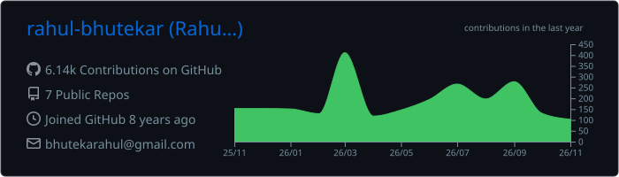
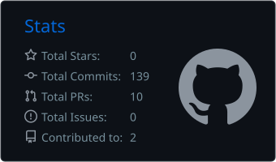
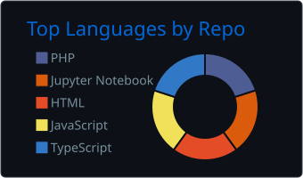
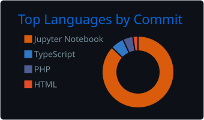

# Hi, I'm Rahul 👋

**Software Engineer | NestJS · React · Prisma · TypeScript | 7+ years backend, now full-stack**

I build backend systems that hold up under real usage, not just demos. After 7+ years in PHP and CodeIgniter, I now work in NestJS, Prisma and React (Vite), using an AI-native workflow with Cursor and Codex.

📍 Pune, India
💼 Software Engineer at Entrata India
🌱 Currently: going deeper into data science
💬 Ask me about: moving from PHP to a modern stack, code review, mentoring new joiners
🤝 Open to: full-time roles and freelance projects (web development, database development, IT consulting)
🌐 Portfolio: [rahul-bhutekar-portfolio.vercel.app](https://rahul-bhutekar-portfolio.vercel.app/)

## 🛠️ Tech stack

**AI tools:** Cursor · Codex

## 📌 What I've worked on

- Integrated the Master Policy and Markel Policy systems into a core product at Entrata
- Built React (Vite) modules on top of NestJS services
- Booking engine work, plus Google Hotel Ads and Google Analytics V4 API integrations, at INNsight
- Co-authored "VIVA-Tech SAM", a student attendance management system
- Patent: *Systems and Methods for Ideogram Based Authentication*

## 📈 GitHub stats

  
  

  
  

## 📫 Let's connect

[LinkedIn](https://www.linkedin.com/in/bhutekar-rahul) · [Portfolio](https://rahul-bhutekar-portfolio.vercel.app/)
